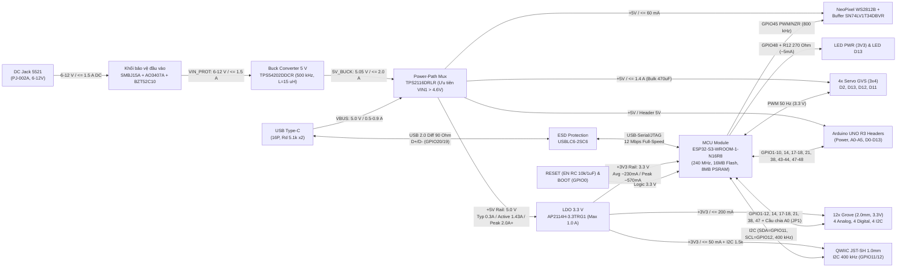

x # PHASE 1 — PHÂN TÍCH KIẾN TRÚC, LỰA CHỌN LINH KIỆN (BOM) & GIẢI ĐÁP KỸ THUẬT [1]–[13]

**Dự án:** CO2037 — Dự án 1: Thiết kế lại bo mạch Yolo UNO (ESP32-S3-WROOM-1, chuẩn Arduino UNO R3, 12 cổng Grove, QWIIC, 4× Servo GVS)  
**Tiêu chuẩn thiết kế:** PCB 4 lớp (`F.Cu / In1.Cu Solid GND / In2.Cu Split Power / B.Cu`), IPC-2221 Class 2, Zero-ERC & Zero-DRC trên KiCad  
**Trạng thái:** Hoàn thành Giai đoạn 1 — Chờ duyệt tại **Review Gate 1** trước khi chuyển sang Giai đoạn 2 (Vẽ Schematic KiCad)

---

## 1. Giới thiệu, Đặc tả R1–R11 & Giải quyết mâu thuẫn kỹ thuật

Mục tiêu của dự án là thiết kế lại hoàn chỉnh bo mạch phát triển **Yolo UNO** sử dụng module vi điều khiển **ESP32-S3-WROOM-1**, tương thích cơ khí và sơ đồ chân **Arduino UNO R3**, tích hợp **12 cổng Grove**, **1 cổng QWIIC**, **4 kênh Servo GVS**, **USB Type-C** (native USB-Serial/JTAG) và hệ thống nguồn kép **USB-C / Jack DC 5521 (6–12 V)** có bảo vệ toàn diện.

### 1.1. Bảng đối chiếu đáp ứng yêu cầu R1–R11

| Mã | Yêu cầu | Giải pháp chốt của nhóm | Trạng thái |
| :--- | :--- | :--- | :--- |
| **R1** | Vi điều khiển | Module **`ESP32-S3-WROOM-1-N16R8`** (lõi kép Xtensa LX7 240 MHz, Wi-Fi 2.4 GHz, BLE 5 + Mesh, native USB, **16 MB Quad Flash**, **8 MB Octal PSRAM**). | Đáp ứng 100% |
| **R2** | Nguồn vào | Hai nguồn: USB Type-C (`5 V`) + DC Jack 5521 (`6–12 V`, `PJ-002A`). Chống ngược cực bằng MOSFET `AO3407A` + Zener `10 V` + TVS `SMBJ15A`; chọn nguồn không dòng ngược bằng IC Power-Mux `TPS2116DRLR`. | Đáp ứng 100% |
| **R3** | Ray nguồn | Ray `+5V` (Buck đồng bộ `TPS54202` xuất `5.05 V / 2 A` cho Servo, NeoPixel, Header `5V`) + Ray `+3V3` (LDO `AP2114H-3.3` `1.0 A` cho ESP32-S3, Grove, QWIIC). Header nguồn UNO R3 đầy đủ (`NC, IOREF=3V3, RESET, 3V3, 5V, GND, GND, VIN`). | Đáp ứng 100% |
| **R4** | Nạp chương trình | Qua cổng USB Type-C (`TYPE-C-31-M-12`) nối trực tiếp native USB (`D− = GPIO19`, `D+ = GPIO20`) qua IC ESD `USBLC6-2SC6`. `UART0` (`GPIO43/GPIO44`) đưa ra `D1/TX` và `D0/RX`. | Đáp ứng 100% |
| **R5** | Nút nhấn | Nút `RESET` (`EN` với mạch trễ RC `10 kΩ / 1 µF`) và nút `BOOT` (`GPIO0` kéo GND + trở kéo lên tùy chọn `10 kΩ`). | Đáp ứng 100% |
| **R6** | Hiển thị | LED nguồn xanh (`D3` trên `+3V3`), LED người dùng `D13` đỏ (`D4` trên `GPIO48`, `R12 = 270 Ω`), LED RGB NeoPixel (`D5 = WS2812B` nguồn `+5V`) lái qua IC đệm dịch mức `SN74LV1T34DBVR` từ `GPIO45`. | Đáp ứng 100% |
| **R7** | 12 cổng Grove | 4× Analog (Vàng), 4× Digital (Trắng), 4× I2C (Đỏ), bước `2.0 mm`, thứ tự `SIG1 – SIG2 – VCC – GND`. Toàn bộ 12 cổng dùng `VCC = +3V3` an toàn cho GPIO ESP32-S3; riêng chân `A0` có thêm cầu chia áp tùy chọn `JP1` (`0–5 V → 0–2.98 V`) theo Câu [10]. | Đáp ứng 100% |
| **R8** | 4× Servo GVS | Header `3×4` bước `2.54 mm` (`GND – +5V – SIG`) cho `D2 (GPIO5)`, `D13 (GPIO48)`, `D12 (GPIO47)`, `D11 (GPIO38)`, kèm tụ bulk `470 µF / 10 V` (`C18`) ngay cạnh header. | Đáp ứng 100% |
| **R9** | QWIIC / STEMMA QT | Cổng JST-SH `1.0 mm` 4 chân ngang (`SM04B-SRSS-TB`: `GND, +3V3, SDA=GPIO11, SCL=GPIO12`) dùng chung 1 cặp điện trở kéo lên `1.5 kΩ` (`R14, R15`) với 4 cổng Grove I2C và `A4/A5`. | Đáp ứng 100% |
| **R10** | Cơ khí & Stackup | Form factor Arduino UNO R3 (`68.6 × 53.4 mm`, tối đa `≤ 75 × 56 mm`), 4 lỗ ốc bắt vít chuẩn UNO R3; nâng cấp lên **PCB 4 lớp** (`F.Cu / In1.Cu Solid GND / In2.Cu Split +3V3 & +5V / B.Cu`) để kiểm soát trở kháng vi sai USB `90 Ω` và mặt phẳng tiếp địa liên tục. | Đáp ứng & nâng cấp |
| **R11** | Ánh xạ chân | Khớp hoàn toàn Hình 4 và Bảng 2 (`D0–D13`, `A0–A5`, `NeoPixel = GPIO45`, `BOOT = GPIO0`, `USB = GPIO19/20`, cộng bổ sung `A6 = GPIO14`). | Đáp ứng 100% |

### 1.2. Giải quyết mâu thuẫn tài liệu & các điểm bổ sung kỹ thuật

1. **Chốt biến thể `ESP32-S3-WROOM-1-N16R8` (Flash 4 MB vs 16 MB):**
   - Tài liệu đề bài nêu mâu thuẫn giữa `4 MB` (bảng thông số) và `16 MB` (mô tả). Nhóm quyết định chọn **`ESP32-S3-WROOM-1-N16R8`** (tích hợp chip `ESP32-S3R8`, **16 MB Quad SPI Flash** + **8 MB Octal SPI PSRAM**).
   - **Kiểm tra ràng buộc chân theo Espressif Datasheet:**
     - Vì dùng **Octal SPI PSRAM (R8)**, 3 chân **`GPIO35`, `GPIO36`, `GPIO37`** bị chiếm dụng nội bộ làm đường dữ liệu/lệnh cho bus Octal PSRAM và **tuyệt đối không được đưa ra ngoại vi**. Đối chiếu Bảng 2 của đề bài (`GPIO0–12, 17–21, 38, 43–48`), không có bất kỳ chân nào dùng `GPIO35/36/37`, do đó hoàn toàn không xung đột.
     - Trên biến thể `N16R8` chuẩn, **`VDD_SPI` cấp cho Flash/PSRAM là `3.3 V`** (xác định bởi chân strapping `GPIO45 = 0` lúc khởi động, khác với các biến thể `1.8 V` như `N16R16VA`). Vì vậy, toàn bộ GPIO liên quan (`GPIO47`, `GPIO48`) hoạt động ở mức logic chuẩn `3.3 V` và **bắt buộc đảm bảo `GPIO45 = 0` khi reset**.
2. **Xử lý chân `A6` trên cổng Grove `A6–A3` (Hình 4 vs Bảng 2):**
   - Hình 4 ký hiệu cổng Grove vàng bên trái là `A6 – A3`, nhưng Bảng 2 chỉ liệt kê `A0–A5`. Để cổng Grove thứ 4 không bị bỏ trống 1 chân tín hiệu, nhóm ánh xạ **`A6 → GPIO14 (ADC2_CH3)`** (khớp thiết kế tham khảo của Yolo UNO thương mại), và không nối `A6` vào header Arduino (do header Analog UNO R3 chỉ có 6 chân `A0–A5`).
3. **Header nguồn Arduino UNO R3 chuẩn 8 chân:**
   - Hình 4 vẽ 7 chân nguồn, bỏ qua chân `NC` ngoài cùng bên trái. Nhóm sử dụng socket `1×08` chuẩn cơ khí Arduino UNO R3 (`Pin 1: NC`, `Pin 2: IOREF = +3V3`, `Pin 3: RESET`, `Pin 4: +3V3`, `Pin 5: +5V`, `Pin 6: GND`, `Pin 7: GND`, `Pin 8: VIN`) để đảm bảo mọi shield Arduino UNO R3 tiêu chuẩn cắm vào không bị lệch chân.
4. **Lựa chọn PCB 4 lớp (thay vì 2 lớp cơ bản):**
   - PCB 4 lớp (`F.Cu` – `In1.Cu Solid GND` – `In2.Cu Split +3V3 / +5V` – `B.Cu`) cho phép: (a) mặt phẳng tiếp địa `In1.Cu` liền mạch 100% dưới cặp vi sai USB và mạch Buck giúp giảm vòng lặp EMI và đạt trở kháng vi sai $Z_{\text{diff}} \approx 90\,\Omega$ ($w = 0.25\text{ mm}, s = 0.20\text{ mm}, h = 0.2\text{ mm}$); (b) giảm trở kháng nhiệt $R_{\theta JA}$ cho LDO `AP2114H-3.3` và nguồn Buck `TPS54202`; (c) tránh đứt mạch đất (zone choking) giữa 12 cổng Grove dày đặc.

---

## 2. Sơ đồ khối hệ thống (Thiết kế riêng của nhóm)

Sơ đồ dưới đây trình bày kiến trúc chi tiết do nhóm thiết kế, chỉ rõ **điện áp, dòng điện ước tính (trung bình / đỉnh) và giao thức** trên từng đường kết nối:

---

## 3. Lựa chọn linh kiện & So sánh phương án (`Bảng 6`)

### 3.1. Bảng lựa chọn linh kiện chính và lý do kỹ thuật

| Khối | Linh kiện / MPN (LCSC) | Thông số then chốt | Lý do chọn (so sánh với phương án thay thế) |
| :--- | :--- | :--- | :--- |
| **Bảo vệ đầu vào** | **`SMBJ15A`** (`C113954`) + **`AO3407A`** (`C347475`) + **`BZT52C10`** (`C81598`) | TVS 15 V 600 W; P-MOSFET `-30 V, ±20 V VGS, -4.3 A, RDS(on) ≤ 48 mΩ @ -10 V`; Zener 10 V kẹp `VGS` | Chọn P-MOSFET `AO3407A` thay vì diode Schottky `SS34`: ở dòng `1.5 A`, `SS34` sụt áp `~0.45 V` (tỏa nhiệt `0.675 W`), còn `AO3407A` chỉ sụt `≤ 72 mV` (tổn hao `≤ 0.108 W`, giảm `6.2×` tổn hao và giữ biên áp khi `VIN = 6 V`). |
| **Hạ áp 5 V** | **`TPS54202DDCR`** (`C128249`) + `L1 = SRN6045TA-150M` (`15 µH, Isat ≥ 2.9 A`) | Synchronous Buck `4.5–28 V → 5.05 V`, `2.0 A` liên tục, `fsw = 500 kHz`, `VFB = 0.596 V`, `η ≈ 88–90%`, `SOT-23-6` | Tích hợp cả 2 MOSFET đồng bộ (không cần diode hồi tiếp ngoài như `MP1584` hay `LM2596`), tiết kiệm diện tích PCB, ít nhiễu EMI hơn nhờ gói `SOT-23-6` gọn nhẹ, và giảm nhiệt hơn `10×` so với LDO `AMS1117-5.0` (xem Câu [3]). |
| **Chọn nguồn USB/DC** | **`TPS2116DRLR`** (`C2875184`) | Dual-Input Power Mux `1.6–5.5 V, 2.5 A`, `RON = 40 mΩ typ`, Reverse-Current Blocking, `IQ = 1.2 µA`, `SOT-5X3-8` | Vượt trội hơn hẳn 2 diode Schottky OR-ing (vốn gây sụt áp `0.45 V` làm ray 5 V tụt xuống `4.55 V` khiến servo yếu) và gọn hơn mạch 2 P-MOSFET rời; `TPS2116` chỉ sụt `~40 mV @ 1 A` (`V_5V ≈ 5.01 V`), tự động ưu tiên nguồn DC (`VSW = 4.60 V`) và chặn hoàn toàn dòng ngược vào USB PC. |
| **Ổn áp 3,3 V** | **`AP2114H-3.3TRG1`** (`C151275`) | Fixed `3.3 V`, `I_max = 1.0 A`, `VDO = 450 mV typ / 750 mV max @ 1 A`, `IQ = 60 µA`, `R_θJA = 128 °C/W` (min pad), `SOT-223` | Đáp ứng dòng đỉnh Wi-Fi (`355–500 mA` + ngoại vi) nhờ định mức `1.0 A` (loại `SPX3819` `500 mA` và `RT9080` `600 mA` vì `< 800 mA`). Chọn thay `AMS1117-3.3` vì `AP2114H` có `VDO` thấp hơn gần `3×` (`450 mV` vs `1.2–1.3 V`), không bị tụt áp `3.3 V` khi chạy USB có `VBUS` thấp `4.5–4.7 V` (xem Câu [1]). |
| **Vi điều khiển** | **`ESP32-S3-WROOM-1-N16R8`** (`C2913202`) | Dual Xtensa LX7 `240 MHz`, Wi-Fi/BLE 5, Native USB, `16 MB` Flash + `8 MB` Octal PSRAM (`VDD_SPI = 3.3 V`) | Chọn `N16R8` (16 MB Flash) thay cho `N4R8` (4 MB) để đáp ứng dung lượng tối đa trong đề bài, dư chỗ cho MicroPython/OTA/AI audio-vision; kiểm chứng không xung đột `GPIO35–37`. |
| **USB Type-C + ESD** | **`TYPE-C-31-M-12`** (`C165948`) + **`USBLC6-2SC6`** (`C7519`) + 2× `5.1 kΩ` (`R9, R10`) | 16-pin USB 2.0 Type-C; ESD `2.5 pF` siêu thấp bảo vệ `D+/D−` và `VBUS`, kẹp `±15 kV` IEC 61000-4-2 | Tụ ký sinh của `USBLC6-2SC6` chỉ `~2.5 pF` không làm méo xung cặp vi sai USB `90 Ω`; hai trở `5.1 kΩ` độc lập trên `CC1` và `CC2` đảm bảo nhận diện Sink chuẩn USB-C trên mọi loại cáp (xem Câu [5]). |
| **LED / NeoPixel** | **`19-217/GHC`** (PWR) + **`19-217/R6C`** (D13) + **`WS2812B-B`** (`C114586`) + **`SN74LV1T34DBVR`** (`C100018`) | Buffer CMOS đơn `SOT-23-5`, `VCC = 5 V`, `VIH(min) = 2.0 V < 3.3 V`, `VIL(max) = 0.8 V`; kèm `R13 = 10 kΩ` pull-down `GPIO45` | `SN74LV1T34DBVR` giải quyết triệt để vấn đề `VIH(min) = 3.5 V` của `WS2812B` ở nguồn `5 V` mà không giảm độ sáng LED như giải pháp hạ áp bằng diode, đồng thời cách ly trở kháng cao giúp `GPIO45` luôn ở mức `0` khi boot. |
| **Kết nối & Analog** | 12× Grove 2.0 mm (`TW-2.0-4P`), `SM04B-SRSS-TB` (QWIIC), `PinHeader 3×4` (Servo), UNO R3 Headers, `R14/R15 = 1.5 kΩ`, `R16/R17 = 6.8k/10k` + `JP1`, `C18 = 470 µF` | `1.5 kΩ` đạt chuẩn I2C 400 kHz @ 200 pF; cầu chia `6.8k/10k` cho `A0` (`5.0 V → 2.976 V`); tụ bulk `470 µF / 10 V` cho Servo | Tất cả Grove dùng `3.3 V` bảo vệ an toàn mọi GPIO ESP32-S3, riêng `A0` tích hợp cầu phân áp tùy chọn `JP1` cho phép cắm cảm biến analog `0–5 V` an toàn (xem Câu [10]). |

### 3.2. Tính toán chi tiết linh kiện khối Buck (`TPS54202`) & Power-Mux (`TPS2116`)

1. **Khối hạ áp 5 V (`U1 = TPS54202DDCR`):**
   - Điện áp tham chiếu nội: $V_{\text{FB}} = 0.596\text{ V}$, tần số chuyển mạch $f_{\text{sw}} = 500\text{ kHz}$ (TPS54202 Datasheet, SLVSDF5).
   - Chọn cầu phân áp hồi tiếp chuẩn E24 `1%`: $R_3 = 68.0\text{ k}\Omega$, $R_4 = 9.10\text{ k}\Omega$:
     $$V_{\text{OUT}} = V_{\text{FB}} \times \left(1 + \frac{R_3}{R_4}\right) = 0.596 \times \left(1 + \frac{68.0}{9.10}\right) = 5.0496\text{ V} \approx 5.05\text{ V}$$
     *(Đặt cao hơn `5.00 V` khoảng `50 mV` để bù sụt áp nhỏ `~40 mV` qua công tắc `TPS2116` khi tải `1 A`.)*
   - Chọn cuộn cảm $L_1 = 15\,\mu\text{H}$ (`Bourns SRN6045TA-150M`, $I_{\text{sat}} \ge 2.9\text{ A}, I_{\text{rms}} \ge 2.5\text{ A}$). Tại $V_{\text{IN(max)}} = 12\text{ V}$:
     $$\Delta I_L = \frac{V_{\text{OUT}} \cdot (V_{\text{IN}} - V_{\text{OUT}})}{V_{\text{IN}} \cdot L_1 \cdot f_{\text{sw}}} = \frac{5.05 \times (12 - 5.05)}{12 \times 15\times 10^{-6} \times 500\times 10^{3}} = 0.390\text{ A}$$
     $$I_{L(\text{peak})} = I_{\text{OUT(max)}} + \frac{\Delta I_L}{2} = 2.00 + \frac{0.390}{2} = 2.195\text{ A} < 2.9\text{ A } (I_{\text{sat}})$$
   - Tụ ngõ vào $C_3 = 10\,\mu\text{F / 25 V}$ + $100\text{ nF}$, tụ bootstrap $C_4 = 100\text{ nF}$, tụ ngõ ra $C_5 \parallel C_6 = 2 \times 22\,\mu\text{F / 16 V X5R}$ (`44 µF` danh định giúp giảm gợn áp ngõ ra $< 20\text{ mV}_{\text{pp}}$).
2. **Khối Power-Mux (`U2 = TPS2116DRLR`):**
   - Cấu hình **Priority Mode** ưu tiên `VIN1 = 5V_BUCK` (nối `MODE` tới `VIN1`). Khi `5V_BUCK` lớn hơn ngưỡng $V_{\text{SW}}$, `U2` tự động cắt `VIN2 (VBUS)` để ưu tiên dùng nguồn DC công suất lớn, không rút dòng từ cổng USB máy tính.
   - Chọn cầu phân áp chân `PR1` ($V_{\text{REF}} = 1.0\text{ V}$ theo TI TPS2116 Datasheet): $R_5 = 36.0\text{ k}\Omega$, $R_6 = 10.0\text{ k}\Omega$:
     $$V_{\text{SW}} = 1.0\text{ V} \times \left(1 + \frac{R_5}{R_6}\right) = 1.0 \times \left(1 + \frac{36.0}{10.0}\right) = 4.60\text{ V}$$

---

## 7. Trả lời các câu hỏi kỹ thuật (`Câu [1]` – `Câu [13]`)

### Câu [1]: So sánh và lựa chọn IC ổn áp 3,3 V

- **Tóm tắt đề:** Tìm hiểu, so sánh ít nhất 3 IC ổn áp 3,3 V có thể dùng cho mạch (dòng định mức, điện áp dropout, dòng tĩnh $I_Q$, kiểu vỏ, giá tham khảo, nguồn) và chọn 1 IC kèm giải thích.
- **Phân tích & Bảng so sánh:** Theo Espressif ESP32-S3 Datasheet, nguồn cấp 3,3 V phải cung cấp tối thiểu $500\text{ mA}$ khi phát Wi-Fi; cộng thêm cảm biến Grove/QWIIC, mục 6.4 yêu cầu chọn LDO có $I_{\text{OUT}} \ge 800\text{ mA}$ (loại bỏ `SPX3819` $500\text{ mA}$ và `RT9080` $600\text{ mA}$). So sánh 3 LDO $\ge 1\text{ A}$ phổ biến:

| Thông số | **`AP2114H-3.3TRG1`** (Diodes Inc.) — **ĐƯỢC CHỌN** | **`AMS1117-3.3`** (Advanced Monolithic) | **`AP7361C-33ER-13`** (Diodes Inc.) |
| :--- | :--- | :--- | :--- |
| **Dòng định mức ($I_{\text{max}}$)** | $1.0\text{ A}$ | $1.0\text{ A}$ | $1.0\text{ A}$ |
| **Điện áp Dropout ($V_{\text{DO}}$)** | **$450\text{ mV}$ typ / $750\text{ mV}$ max** @ $1\text{ A}$ ($\approx 270\text{ mV}$ @ $0.6\text{ A}$) | $1.2–1.3\text{ V}$ typ / $1.4\text{ V}$ max @ $1\text{ A}$ | $360–440\text{ mV}$ typ @ $1\text{ A}$ |
| **Dòng tĩnh ($I_Q$)** | **$60\,\mu\text{A}$ typ / $80\,\mu\text{A}$ max** | $5\text{ mA}$ typ / $10–13\text{ mA}$ max | $60–80\,\mu\text{A}$ typ |
| **Dải điện áp vào ($V_{\text{IN}}$)** | Tối đa $6.0\text{ V}$ | Tối đa $15–18\text{ V}$ | $2.2\text{ V} – 6.0\text{ V}$ |
| **Kiểu vỏ & Pinout** | `SOT-223` (Tab = $V_{\text{OUT}}$, chuẩn phổ thông) | `SOT-223` (Tab = $V_{\text{OUT}}$) | `SOT-223` / `SOT-223R` (nhiều biến thể khác chân Tab) |
| **$R_{\theta JA}$ (JEDEC min pad)** | $128\,^\circ\text{C/W}$ ($R_{\theta JC} = 50.9\,^\circ\text{C/W}$) | $85–90\,^\circ\text{C/W}$ | $110\,^\circ\text{C/W}$ |
| **Giá tham khảo (LCSC)** | $\sim \$0.14 – \$0.20$ | $\sim \$0.04 – \$0.08$ | $\sim \$0.18 – \$0.25$ |

- **Lý do lựa chọn `AP2114H-3.3TRG1`:**
  1. Nếu cổng USB trên laptop sụt áp xuống $4.5\text{ V}$ (hoặc qua diode bảo vệ còn $4.55\text{ V}$), `AMS1117-3.3` có $V_{\text{DO}} \approx 1.2–1.3\text{ V}$ sẽ tụt áp ngõ ra xuống $4.55 - 1.3 = 3.25\text{ V}$ (gần ngưỡng brownout nếu thêm xung Wi-Fi), còn `AP2114H-3.3` chỉ cần $V_{\text{IN}} \ge 3.3 + 0.45 = 3.75\text{ V}$ ở $1\text{ A}$, đảm bảo ray `3V3` cực kỳ ổn định.
  2. Dòng tĩnh $I_Q = 60\,\mu\text{A}$ nhỏ hơn hơn $80\times$ so với `AMS1117-3.3`, tiết kiệm năng lượng khi sleep.
  3. Có tích hợp bảo vệ quá nhiệt, giới hạn dòng và chân chuẩn `SOT-223` tương thích phổ thông dễ thay thế hơn `AP7361C`.
- **Nguồn tham khảo:** Diodes Inc. *AP2114 Datasheet*; Advanced Monolithic Systems *AMS1117 Datasheet*; Diodes Inc. *AP7361C Datasheet*.

---

### Câu [2]: Công suất tiêu tán và nhiệt độ mối nối trên LDO 3,3 V

- **Tóm tắt đề:** Ray $3.3\text{ V}$ tiêu thụ trung bình $I_{\text{avg}} = 350\text{ mA}$, đỉnh $I_{\text{peak}} = 600\text{ mA}$ từ đầu vào $V_{\text{IN}} = 5.0\text{ V}$. Tính công suất tiêu tán $P_D$ và nhiệt độ mối nối $T_J$ khi $T_A = 40\,^\circ\text{C}$; đánh giá mức đạt yêu cầu.
- **Công thức & Tính toán:**
  - Công suất tiêu tán trên LDO:
    $$P_D = (V_{\text{IN}} - V_{\text{OUT}})\cdot I_{\text{OUT}} + V_{\text{IN}}\cdot I_Q$$
    Với `AP2114H-3.3TRG1`, $I_Q = 60\,\mu\text{A} = 6\times 10^{-5}\text{ A}$:
    - **Chế độ trung bình ($350\text{ mA}$):**
      $$P_{D(\text{avg})} = (5.0 - 3.3)\times 0.35 + 5.0\times 6\times 10^{-5} = 0.5950 + 0.0003 = \mathbf{0.5953\text{ W}}$$
    - **Chế độ đỉnh ($600\text{ mA}$):**
      $$P_{D(\text{peak})} = (5.0 - 3.3)\times 0.60 + 5.0\times 6\times 10^{-5} = 1.0200 + 0.0003 = \mathbf{1.0203\text{ W}}$$
  - Nhiệt độ mối nối ($T_J = T_A + P_D \cdot R_{\theta JA}$ với $T_A = 40\,^\circ\text{C}$, $T_{J(\text{max})} = 125\,^\circ\text{C}$ theo Datasheet):
    1. **Trường hợp 1 — Pad đồng tối thiểu theo JEDEC ($R_{\theta JA} = 128\,^\circ\text{C/W}$):**
       - $T_{J(\text{avg})} = 40 + 0.5953 \times 128 = \mathbf{116.20\,^\circ\text{C}}$ ($< 125\,^\circ\text{C}$, biên an toàn rất hẹp).
       - $T_{J(\text{peak})} = 40 + 1.0203 \times 128 = \mathbf{170.60\,^\circ\text{C}}$ (**Quá nhiệt $> 125\,^\circ\text{C}$**, sẽ kích hoạt ngắt bảo vệ nhiệt nếu tải $600\text{ mA}$ kéo dài).
    2. **Trường hợp 2 — Thiết kế tản nhiệt PCB 4 lớp thực tế của nhóm ($R_{\theta JA,\text{eff}} \approx 65\,^\circ\text{C/W}$):** Nhóm nối Tab tản nhiệt (Pin 2 = `+3V3`) của `SOT-223` ra vùng đồng rộng trên `F.Cu` và đóng cụm thermal via xuống lớp nội `In2.Cu` (`+3V3` plane), giúp giảm $R_{\theta JA}$ xuống $\sim 60–65\,^\circ\text{C/W}$:
       - $T_{J(\text{avg})} = 40 + 0.5953 \times 65 = \mathbf{78.69\,^\circ\text{C}}$
       - $T_{J(\text{peak})} = 40 + 1.0203 \times 65 = \mathbf{106.32\,^\circ\text{C}} < 125\,^\circ\text{C}$
- **Kết luận:** **ĐẠT YÊU CẦU** với điều kiện bắt buộc phải phủ đồng tản nhiệt rộng nối Tab của `AP2114H-3.3` và xuyên via xuống plane nội (đồng thời đỉnh $600\text{ mA}$ của Wi-Fi chỉ diễn ra theo xung ngắn vài ms chứ không liên tục).
- **Nguồn tham khảo:** Diodes Inc. *AP2114 Datasheet*, Thermal Characteristics (`θ_JA = 128 °C/W`, `θ_JC = 50.9 °C/W`, `T_J max operating = 125 °C`).

---

### Câu [3]: So sánh LDO và Buck Converter cho khối hạ áp 12 V → 5 V @ 1 A

- **Tóm tắt đề:** Tính công suất tiêu tán khi dùng LDO hạ $V_{\text{IN}} = 12\text{ V}$ xuống $5\text{ V}$ ở $I = 1\text{ A}$; so sánh với Buck Converter có hiệu suất $\eta = 88\%$ và giải thích lựa chọn.
- **Công thức & Tính toán:**
  - **Phương án 1 — Dùng LDO (bỏ qua $I_Q$):**
    $$P_{\text{OUT}} = 5.0\text{ V}\times 1.0\text{ A} = 5.00\text{ W}$$
    $$P_{D(\text{LDO})} = (V_{\text{IN}} - V_{\text{OUT}})\times I_{\text{OUT}} = (12.0 - 5.0)\times 1.0 = \mathbf{7.00\text{ W}}$$
    Hiệu suất: $\eta_{\text{LDO}} \approx \frac{5}{12} = \mathbf{41.7\%}$. Công suất tiêu tán $7.00\text{ W}$ trên vỏ `SOT-223` hay `TO-220` không có tản nhiệt lớn sẽ đẩy nhiệt độ lên hàng trăm độ C và cháy hoặc ngắt mạch ngay lập tức.
  - **Phương án 2 — Dùng Buck Converter ($\eta = 88\%$):**
    $$P_{\text{IN}} = \frac{P_{\text{OUT}}}{\eta} = \frac{5.00\text{ W}}{0.88} = \mathbf{5.682\text{ W}}$$
    $$P_{\text{loss(Buck)}} = P_{\text{IN}} - P_{\text{OUT}} = 5.682 - 5.000 = \mathbf{0.682\text{ W}}$$
- **Kết luận & Lựa chọn:** Buck Converter giảm tổn hao nhiệt tới **$\frac{7.00}{0.682} \approx 10.27\text{ lần}$** ($0.682\text{ W}$ so với $7.00\text{ W}$), giúp mạch chạy mát khi cấp adapter $12\text{ V}$ và cung cấp dòng dư tới $2\text{ A}$ cho servo. Do đó nhóm chọn IC Buck đồng bộ **`TPS54202DDCR`** (500 kHz, 2 A, hiệu suất $85–90\%$ ở `12V → 5V`).
- **Nguồn tham khảo:** Texas Instruments *TPS54202 Datasheet (SLVSDF5)*, Section Typical Characteristics (12 V to 5 V Efficiency Curves).

---

### Câu [4]: Giải pháp chọn nguồn USB / DC và phân tích sụt áp

- **Tóm tắt đề:** Trình bày giải pháp power-path USB/DC; phân tích điều gì xảy ra nếu nối trực tiếp `VBUS` với `5V_BUCK`; tính điện áp ray 5 V khi dùng diode Schottky $V_F = 0.45\text{ V}$ ở $1\text{ A}$.
- **Hậu quả khi nối trực tiếp `VBUS` với `5V_BUCK`:**
  1. *Khi cắm cả DC và USB:* Nếu `5V_BUCK = 5.05 V` cao hơn `VBUS` từ laptop (`4.8–5.0 V`), dòng điện lớn sẽ **chảy ngược vào cổng USB của máy tính**, kích hoạt bảo vệ quá dòng USB hoặc làm hỏng cổng USB / bo mạch chủ.
  2. *Khi chỉ cắm USB (không cắm Jack DC):* Điện áp `5 V` từ `VBUS` chảy ngược qua **body diode của MOSFET high-side** trong IC Buck lên tụ ngõ vào `VIN_PROT` và mạch bảo vệ đầu vào, gây tổn hao, nóng IC Buck hoặc cấp nguồn ngược bất thường ra Jack DC.
- **Tính sụt áp khi dùng phương án hai diode Schottky OR-ing ($V_F = 0.45\text{ V}$ @ $1\text{ A}$):**
  - Với nguồn $5.00\text{ V}$ danh định:
    $$V_{5\text{V\_rail}} = V_{\text{IN}} - V_F = 5.00 - 0.45 = \mathbf{4.55\text{ V}}$$
    (Nếu nguồn USB thực tế tụt xuống $4.75\text{ V}$, ray 5 V chỉ còn $4.75 - 0.45 = \mathbf{4.30\text{ V}}$, thấp hơn dải tối ưu $4.8–6.0\text{ V}$ của servo SG90, gây rung hoặc yếu mô-men; tổn hao công suất trên diode là $P_D = 0.45\times 1.0 = 0.45\text{ W}$).
- **Giải pháp nhóm đã chọn (`U2 = TPS2116DRLR`):**
  - Nhóm sử dụng IC Power Multiplexer **`TPS2116DRLR`** dùng cặp MOSFET N-kênh đấu đối lưng (*back-to-back*), có tính năng chặn dòng ngược hai chiều (Reverse Current Blocking).
  - Với $R_{\text{ON}} = 40\text{ m}\Omega\text{ typ}$, ở dòng $I = 1.0\text{ A}$, sụt áp chỉ là:
    $$\Delta V = I \cdot R_{\text{ON}} = 1.0 \times 0.040 = \mathbf{0.040\text{ V } (40\text{ mV})}$$
    Do đầu ra Buck là $5.05\text{ V}$, điện áp trên ray `+5V` đạt $5.05 - 0.04 = \mathbf{5.01\text{ V}}$ (đạt chuẩn $5.0\text{ V}$ cho servo và LDO), tổn hao nhiệt chỉ $0.04\text{ W}$ (giảm $>11\times$ so với diode Schottky).
- **Nguồn tham khảo:** Texas Instruments *TPS2116 Datasheet (SLVSFJ9)*.

---

### Câu [5]: Hai điện trở $5.1\text{ k}\Omega$ độc lập trên chân CC1, CC2 của USB Type-C

- **Tóm tắt đề:** Giải thích vì sao mỗi chân `CC1`, `CC2` phải có 1 trở $R_d = 5.1\text{ k}\Omega$ riêng xuống GND; điều gì xảy ra nếu bỏ hoặc dùng chung 1 trở trên cáp `USB-C ↔ USB-C`.
- **Nguyên lý USB Type-C Configuration Channel (CC):**
  - Cổng cấp nguồn (DFP / Source, ví dụ sạc USB-C hoặc cổng USB-C laptop) không cấp sẵn `5 V` lên chân `VBUS` ở trạng thái chờ (*cold socket*). Thay vào đó, phía Source đặt nguồn dòng hoặc điện trở kéo lên $R_p$ (tùy dòng cấp `500 mA / 1.5 A / 3.0 A`) trên các đường `CC1`, `CC2`.
  - Chỉ khi phát hiện phía nhận (UFP / Sink) kéo đường CC hoạt động xuống GND thông qua điện trở $R_d = 5.1\text{ k}\Omega \pm 10\%$ tạo ra điện áp phân áp hợp lệ ($0.25\text{ V} – 2.04\text{ V}$), phía Source mới xác định có thiết bị và đảo chiều cáp để đóng MOSFET cấp `VBUS = 5 V`.
- **Tình huống lỗi trên cáp `USB-C ↔ USB-C`:**
  1. *Nếu bỏ cả hai điện trở $5.1\text{ k}\Omega$:* Cả `CC1` và `CC2` đều hở mạch ($V_{\text{CC}} \approx V_{\text{pull-up}}$). Nguồn USB-C hiểu là chưa cắm thiết bị → **`VBUS = 0 V`**, bo mạch hoàn toàn không có nguồn (chỉ chạy được qua cáp USB-A → USB-C cũ vốn luôn cấp sẵn 5 V).
  2. *Nếu nối chung `CC1` và `CC2` vào một điện trở $5.1\text{ k}\Omega$:* Trong cáp `USB-C ↔ USB-C` có chip E-Marker hoặc mạch tích cực, dây dẫn chỉ nối 1 chân `CC` xuyên suốt tới Source, còn chân `CC` còn lại trong đầu cáp được nối xuống mass qua trở $R_a \approx 800\,\Omega – 1.2\text{ k}\Omega$ để xin cấp nguồn $V_{\text{CONN}}$ cho chip cáp. Khi nối chập `CC1–CC2` trên PCB, $R_d\ (5.1\text{ k}\Omega)$ bị mắc song song với $R_a\ (\approx 1\text{ k}\Omega)$ thành $R_{\text{eq}} \approx 836\,\Omega$! Nguồn Source đọc nhầm trở kháng này là yêu cầu $V_{\text{CONN}}$ / lỗi cáp hoặc tụt dưới ngưỡng `0.25 V`, dẫn đến **ngắt cấp nguồn `VBUS`** (lỗi thực tế kinh điển trên Raspberry Pi 4 bản đầu).
- **Nguồn tham khảo:** USB Implementers Forum, *USB Type-C Cable and Connector Specification*, Section 4.5.1 & Table 4-23/4-26.

---

### Câu [6]: Hằng số thời gian mạch RC trên chân EN và trạng thái nút nhấn RESET

- **Tóm tắt đề:** Từ Hình 6 ($R_1 = 10\text{ k}\Omega$, $C_1 = 1\,\mu\text{F}$), tính hằng số thời gian $\tau$, giải thích lý do cần trễ khởi động, và xác định điện áp $V_{\text{EN}}$ khi nhấn `SW_RST`.
- **Tính toán:**
  - Hằng số thời gian RC:
    $$\tau = R_1 \cdot C_1 = (10\times 10^3\,\Omega)\cdot (1\times 10^{-6}\text{ F}) = \mathbf{10.0\text{ ms}}$$
  - Điện áp nạp trên tụ theo thời gian: $V_{\text{EN}}(t) = V_{\text{DD}}\cdot \left(1 - e^{-t/\tau}\right)$. Để đạt ngưỡng mức cao tối thiểu của ESP32-S3 ($V_{\text{IH}} = 0.75\,V_{\text{DD}} = 2.475\text{ V}$):
    $$t_{\text{delay}} = -\tau \ln(1 - 0.75) = 10.0\text{ ms} \times 1.3863 = \mathbf{13.86\text{ ms}}$$
- **Vì sao ESP32-S3 cần trễ khởi động:** Theo *ESP32-S3 Datasheet* mục *Power-up and Reset Timing*, chân `EN` (`CHIP_PU`) phải giữ ở mức thấp ít nhất $t_0 \ge 50\,\mu\text{s}$ sau khi các đường nguồn `3V3` ổn định hoàn toàn (lớn hơn thời gian tụ lọc và LDO tăng áp lên $3.3\text{ V}$, thường vài ms) và xung reset giữ thấp tối thiểu $t_1 \ge 50\,\mu\text{s}$. Ngoài ra, điện trở kéo lên nội của `EN` rất yếu ($> 2\text{ M}\Omega$). Mạch RC tạo độ trễ $\sim 13.86\text{ ms} \gg 50\,\mu\text{s}$ đảm bảo khối nguồn và bộ dao động ổn định trước khi CPU giải phóng reset, tránh lỗi treo boot hoặc brownout.
- **Điện áp tại chân `EN` khi nhấn `SW_RST`:** Khi nhấn `SW_RST`, tiếp điểm nối thẳng chân `EN` xuống `GND`, xả nhanh tụ $C_1$ nên **`V_EN = 0 V`** (khi đó dòng qua $R_1$ xuống GND là $3.3\text{ V} / 10\text{ k}\Omega = 0.33\text{ mA}$, an toàn và kéo ESP32-S3 vào trạng thái Reset).
- **Nguồn tham khảo:** Espressif Systems, *ESP32-S3 Series Datasheet* & *ESP32-S3 Hardware Design Guidelines*.

---

### Câu [7]: Chân Strapping của ESP32-S3 và xử lý rủi ro GPIO45, GPIO3

- **Tóm tắt đề:** Liệt kê 4 chân strapping của ESP32-S3 cùng mức mặc định; phân tích rủi ro nối NeoPixel vào `GPIO45` và Analog `A2` vào `GPIO3`, nêu giải pháp trong thiết kế.
- **Bảng các chân Strapping của ESP32-S3 (theo Espressif Datasheet):**

| Chân Strapping | Trở nội mặc định | Giá trị mặc định khi boot | Chức năng cấu hình lúc Reset |
| :--- | :--- | :--- | :--- |
| **`GPIO0`** | Pull-up yếu | `1` (Cao) | Chọn chế độ khởi động: `1` = SPI Boot (chạy chương trình Flash); `0` (kèm `GPIO46 = 0`) = Joint Download Boot (nạp code). |
| **`GPIO3`** | Thả nổi (Floating) | Không xác định | Chọn nguồn JTAG khi `EFUSE_STRAP_JTAG_SEL = 1` (`0` = USB-Serial/JTAG, `1` = JTAG ngoài qua GPIO). Mặc định nhà máy `EFUSE_STRAP_JTAG_SEL = 0` nên `GPIO3` không ảnh hưởng boot nếu chưa đốt eFuse. |
| **`GPIO45`** | Pull-down yếu | **`0` (Thấp)** | Chọn điện áp `VDD_SPI` cho Flash/PSRAM: **`0` = `3.3 V`** (chuẩn cho `N16R8`), `1` = `1.8 V`. |
| **`GPIO46`** | Pull-down yếu | **`0` (Thấp)** | Cùng `GPIO0` chọn chế độ boot và bật/tắt in log ROM qua UART0 (`0` = bình thường; tránh kéo `GPIO46 = 1` đồng thời khi `GPIO0 = 0`). |

- **Phân tích rủi ro & Giải pháp thiết kế của nhóm:**
  1. **Rủi ro với `GPIO45` (NeoPixel):** Nếu nối trực tiếp `GPIO45` vào `DIN` của LED `WS2812B` (cấp nguồn `5 V`) hoặc mạch kéo lên nào đó, dòng rò từ ngõ vào `WS2812B` hoặc trở kéo có thể kéo `GPIO45` lên mức cao (`1`) lúc khởi động. Khi đó ESP32-S3 sẽ cấp **`VDD_SPI = 1.8 V`** cho chip Flash/PSRAM vốn thiết kế chạy `3.3 V` trên `N16R8`, làm vi điều khiển **không đọc được Flash và treo hoàn toàn**.
     - *Giải pháp:* Nhóm cách ly `GPIO45` qua IC đệm CMOS tổng trở ngõ vào cực cao **`SN74LV1T34DBVR`** (không rò dòng ngược từ phía `5 V`) **và đặt thêm điện trở kéo xuống `R13 = 10 kΩ` xuống `GND`** để cưỡng bức `GPIO45 = 0 V` chắc chắn tại thời điểm reset, trong khi MCU vẫn điều khiển phát xung 800 kHz mạnh mẽ sau khi boot xong.
  2. **Rủi ro với `GPIO3` (Analog `A2`):** `GPIO3` ở trạng thái thả nổi lúc reset; nếu một cảm biến analog bên ngoài giữ áp cao/thấp trên `A2` trong tình huống sinh viên vô tình kích hoạt `EFUSE_STRAP_JTAG_SEL = 1`, chip có thể chuyển nhầm sang JTAG chân GPIO thay vì USB-JTAG.
     - *Giải pháp:* Giữ cấu hình mặc định eFuse (`EFUSE_STRAP_JTAG_SEL = 0`, bỏ qua `GPIO3` lúc boot), đồng thời ghi chú rõ trên tài liệu/silkscreen để tránh đốt eFuse đổi JTAG khi đang cắm cảm biến trên cổng Grove `A3–A2`.
- **Nguồn tham khảo:** Espressif Systems, *ESP32-S3 Series Datasheet* (Section Strapping Pins) & *ESP32-S3-WROOM-1 Datasheet*.

---

### Câu [8]: Tính toán điện trở LED D13 và thiết kế mạch LED công suất 100 mW

- **Tóm tắt đề:** Chọn $R_{\text{LED}}$ cho LED đỏ ($V_F \approx 2.0\text{ V}$) đạt $I \approx 5\text{ mA}$ từ GPIO $3.3\text{ V}$, tính công suất tiêu tán trên $R_{\text{LED}}$, và đề xuất mạch thay thế nếu lái LED $100\text{ mW}$.
- **Tính toán cho LED đỏ $5\text{ mA}$:**
  $$R_{\text{LED(exact)}} = \frac{V_{\text{GPIO}} - V_F}{I_{\text{LED}}} = \frac{3.3\text{ V} - 2.0\text{ V}}{5\times 10^{-3}\text{ A}} = \frac{1.3}{0.005} = \mathbf{260\,\Omega}$$
  Chọn giá trị chuẩn E12/E24 gần nhất: **`R12 = 270 Ω`** (sai số $1\%$, vỏ SMD `0603`).
  - Dòng thực tế:
    $$I_{\text{actual}} = \frac{3.3 - 2.0}{270} = \mathbf{4.81\text{ mA}} \quad (\ll 20\text{ mA khuyến nghị / } 40\text{ mA tối đa của GPIO ESP32-S3})$$
  - Công suất tiêu tán trên điện trở $R_{12}$:
    $$P_R = I_{\text{actual}}^2 \cdot R_{12} = (0.004815)^2 \times 270 = \mathbf{6.26\text{ mW}}$$
    *(Điện trở `0603` chịu được $100\text{ mW}$, an toàn gấp $16\times$).*
- **Thay đổi mạch khi cần điều khiển LED công suất $100\text{ mW}$:**
  - Với LED đỏ ($V_F \approx 2.0\text{ V}$), dòng tải cần thiết là:
    $$I_{\text{LED(100mW)}} = \frac{P_{\text{LED}}}{V_F} = \frac{0.100\text{ W}}{2.0\text{ V}} = \mathbf{50\text{ mA}}$$
    Dòng $50\text{ mA}$ **vượt giới hạn tối đa $40\text{ mA}$ của chân GPIO ESP32-S3**, do đó không được nối trực tiếp.
  - **Mạch đề xuất:** Dùng khóa chuyển mạch **N-MOSFET mức logic (`2N7002` hoặc `AO3400A`)** (hoặc transistor NPN `S8050` với $R_B = 1\text{ k}\Omega$):
    - Cực Gate nối vào `GPIO48` qua trở hạn dòng $100\,\Omega$ (kèm trở kéo xuống $10\text{ k}\Omega$); cực Source nối `GND`.
    - Cực Drain nối qua điện trở hạn dòng $R_S$ lên cực âm LED, cực dương LED nối ray **`+5V`** (tránh làm nóng LDO `3.3 V`):
      $$R_S = \frac{5.0 - 2.0}{0.050} = 60\,\Omega \implies \text{Chọn } \mathbf{62\,\Omega} \text{ (công suất } P_{R_S} = (0.0484)^2 \times 62 = 145\text{ mW} \to \text{dùng điện trở } 0.25\text{ W} \text{ hoặc } 0.5\text{ W (1206)})$$
- **Nguồn tham khảo:** Espressif Systems, *ESP32-S3 Series Datasheet* (IO Drive Capability).

---

### Câu [9]: Giải quyết tương thích mức logic 3,3 V → 5 V cho NeoPixel (`WS2812B`)

- **Tóm tắt đề:** `WS2812B` nguồn $5\text{ V}$ yêu cầu $V_{\text{IH(min)}} = 0.7 \times V_{\text{DD}}$. Tín hiệu $3.3\text{ V}$ của ESP32-S3 có đảm bảo không? Nêu ít nhất 2 giải pháp và chọn 1 giải pháp.
- **Phân tích định lượng:**
  - Với $V_{\text{DD}} = 5.0\text{ V}$ (hoặc $5.05\text{ V}$), ngưỡng nhận mức cao tối thiểu của `WS2812B`:
    $$V_{\text{IH(min)}} = 0.7 \times 5.0\text{ V} = \mathbf{3.50\text{ V}}$$
  - Mức cao ngõ ra tối đa của GPIO ESP32-S3 cấp nguồn `3.3 V` là $V_{\text{OH}} \le \mathbf{3.30\text{ V}}$ ($V_{\text{OH(min)}} = 0.8\times 3.3 = 2.64\text{ V}$).
  - Vì $3.30\text{ V} < 3.50\text{ V}$ (thiếu tối thiểu $0.20\text{ V}$), tín hiệu `3.3 V` **KHÔNG ĐẢM BẢO** được nhận ổn định (đặc biệt khi nguồn USB/Buck đạt $5.0–5.2\text{ V}$ hoặc ở nhiệt độ cao, LED sẽ nhấp nháy sai màu hoặc không nhận dữ liệu).
- **So sánh 3 giải pháp kỹ thuật:**
  1. **Giải pháp 1 — IC đệm dịch mức đơn `SN74LV1T34DBVR` (ĐƯỢC CHỌN):** Cấp nguồn $V_{\text{CC}} = +5\text{ V}$. Theo TI Datasheet, ở $V_{\text{CC}} = 4.5–5.5\text{ V}$, IC này có ngưỡng nhận mức cao rất thấp **$V_{\text{IH(min)}} = 2.0\text{ V}$** ($V_{\text{IL(max)}} = 0.8\text{ V}$), do đó nhận tín hiệu `3.3 V` của ESP32-S3 cực kỳ thoải mái (biên nhiễu $1.3\text{ V}$) và xuất xung vuông $V_{\text{OH}} \approx 5.0\text{ V}$ đạt chuẩn $3.50\text{ V}$ cho `WS2812B`, đồng thời giữ trọn độ sáng LED `5 V` và cách ly bảo vệ chân strapping `GPIO45`.
  2. **Giải pháp 2 — Diode hạ áp cho LED:** Mắc 1 diode silicon (`1N4148` / `1N4007`, $V_F \approx 0.7\text{ V}$) nối tiếp nguồn `5 V` vào `VDD` của LED `WS2812B`, hạ nguồn LED xuống $V_{\text{DD,LED}} \approx 4.3\text{ V}$, kéo $V_{\text{IH(min)}} = 0.7 \times 4.3 = 3.01\text{ V} < 3.3\text{ V}$. Nhược điểm: giảm độ sáng và không bảo vệ strapping pin tốt bằng IC đệm.
  3. **Giải pháp 3 — Thay loại LED hỗ trợ 3,3 V:** Dùng `WS2812B-V5` hoặc `SK6812MINI-E` cấp nguồn thẳng `+3V3`. Nhược điểm: tiêu thụ dòng $60\text{ mA}$ từ LDO `3.3 V` làm tăng nhiệt LDO.
- **Kết luận:** Nhóm chọn **Giải pháp 1 (`U6 = SN74LV1T34DBVR` + `R13 = 10 kΩ`)** vì tính chuẩn xác công nghiệp, sườn xung 800 kHz sắc nét và bảo vệ chân strapping `GPIO45`.
- **Nguồn tham khảo:** Worldsemi *WS2812B Datasheet*; Texas Instruments *SN74LV1T34 Datasheet*.

---

### Câu [10]: Mạch giao tiếp cảm biến Analog 0–5 V vào chân A0 (`ADC1_CH0`)

- **Tóm tắt đề:** Cảm biến Grove cấp 5 V xuất tín hiệu `0–5 V`. Thiết kế mạch đưa vào `A0` (`GPIO1 / ADC1_CH0`) an toàn và tận dụng tối đa tầm đo ADC (`0–3.1 V` ở suy giảm `11 dB`); tính giá trị linh kiện và trở kháng ra.
- **Thiết kế mạch của nhóm (Cầu phân áp chuẩn E12 + tụ bù lấy mẫu SAR + Jumper chọn chế độ `JP1`):**
  - Tầm đo đầy thang của ESP32-S3 ADC1 ở cấu hình `ADC_ATTEN_DB_11` là $V_{\text{FS}} = 3.10\text{ V}$ (giới hạn chịu áp tuyệt đối trên chân GPIO là $V_{\text{DD}} + 0.3 = 3.6\text{ V}$).
  - Nhóm đặt trên đường `A0` một cầu phân áp điện trở chuẩn **E12 (`1%`)** gồm $R_{16} = \mathbf{6.8\text{ k}\Omega}$ (nối tiếp từ đầu vào cảm biến) và $R_{17} = \mathbf{10.0\text{ k}\Omega}$ (nối xuống GND), thông qua cầu hàn 3 chân `JP1` (mặc định nối thẳng `3.3 V` nếu dùng Grove 3.3 V; chuyển hàn sang cầu chia nếu cắm cảm biến `0–5 V`).
- **Tính toán điện áp ngõ ra & trở kháng ra (Thevenin):**
  - Với $V_{\text{in(max)}} = 5.00\text{ V}$:
    $$V_{\text{A0(max)}} = V_{\text{in}} \cdot \frac{R_{17}}{R_{16} + R_{17}} = 5.00 \times \frac{10.0}{6.8 + 10.0} = \mathbf{2.976\text{ V}} \le 3.10\text{ V}$$
    *(Tận dụng **$96.0\%$** dải đo $0–3.1\text{ V}$ của ADC1, đồng thời giữ khoảng an toàn nếu nguồn 5 V của cảm biến dao động lên $5.25\text{ V} \implies V_{\text{A0}} = 3.125\text{ V} < 3.3\text{ V}$, hoàn toàn không hỏng chân ADC).*
    *(Ghi chú: nếu dùng dãy E24, có thể chọn $R_{16} = 6.2\text{ k}\Omega / R_{17} = 10\text{ k}\Omega$ cho $V_{\text{A0}} = 3.086\text{ V}$, sát $3.10\text{ V}$ hơn).*
  - **Trở kháng ra tương đương Thevenin:**
    $$R_{\text{out}} = R_{16} \parallel R_{17} = \frac{6.8\text{ k}\Omega \times 10.0\text{ k}\Omega}{6.8\text{ k}\Omega + 10.0\text{ k}\Omega} = \mathbf{4.048\text{ k}\Omega} \quad (< 10\text{ k}\Omega)$$
  - Đặt thêm tụ $C_{17} = 100\text{ nF}$ song song với $R_{17}$ sát chân `GPIO1` để lọc nhiễu cao tần và đóng vai trò hồ chứa điện tích cho tụ lấy mẫu ADC SAR. (Nếu cảm biến có nội trở ra rất cao $> 50\text{ k}\Omega$, có thể thay bằng mạch đệm Op-Amp Rail-to-Rail như `MCP6001` cấp nguồn `3.3 V` đặt sau cầu phân áp để hạ $R_{\text{out}} < 10\,\Omega$).
- **Nguồn tham khảo:** Espressif Systems, *ESP32-S3 Series Datasheet* (ADC Characteristics, `ATTEN3 = 3100 mV`).

---

### Câu [11]: Tính điện trở kéo lên cho Bus I2C 400 kHz ($C_b = 200\text{ pF}$)

- **Tóm tắt đề:** Bus I2C (4 cổng Grove I2C + QWIIC + `A4/A5`) chạy tốc độ $400\text{ kHz}$ (Fast Mode), $C_b = 200\text{ pF}$, $V_{\text{DD}} = 3.3\text{ V}$, $V_{\text{OL}} = 0.4\text{ V}$, $I_{\text{OL}} = 3\text{ mA}$, $t_r = 300\text{ ns}$. Tìm khoảng giá trị $R_p$ hợp lệ và chọn giá trị chuẩn E12.
- **Tính toán theo chuẩn NXP UM10204:**
  - **Giới hạn dưới ($R_{p(\text{min})}$ — đảm bảo MOSFET kéo xuống vẫn giữ được $V_{\text{OL}} \le 0.4\text{ V}$):**
    $$R_{p(\text{min})} = \frac{V_{\text{DD}} - V_{\text{OL}}}{I_{\text{OL}}} = \frac{3.3 - 0.4}{3\times 10^{-3}} = \frac{2.9}{0.003} = \mathbf{966.67\,\Omega}$$
  - **Giới hạn trên ($R_{p(\text{max})}$ — đảm bảo thời gian sườn lên $t_r \le 300\text{ ns}$):**
    $$R_{p(\text{max})} = \frac{t_r}{0.8473 \cdot C_b} = \frac{300\times 10^{-9}}{0.8473 \times 200\times 10^{-12}} = \mathbf{1770.33\,\Omega}$$
  - **Khoảng giá trị hợp lệ:**
    $$\mathbf{966.67\,\Omega \le R_p \le 1770.33\,\Omega}$$
- **Chọn giá trị chuẩn E12:** Các giá trị chuẩn trong dãy E12 nằm trong khoảng này là $1.0\text{ k}\Omega, 1.2\text{ k}\Omega, 1.5\text{ k}\Omega$. Nhóm chọn **`R14 = R15 = 1.5 kΩ`** ($1\%$, `0603`) vì:
  - Thời gian sườn lên thực tế: $t_r = 0.8473 \times 1500 \times 200\times 10^{-12} = \mathbf{254.2\text{ ns}} \le 300\text{ ns}$ (đạt chuẩn Fast Mode 400 kHz).
  - Dòng sink khi kéo xuống thấp: $I_{\text{OL}} = \frac{3.3 - 0.4}{1500} = \mathbf{1.93\text{ mA}} \le 3\text{ mA}$ (nhẹ tải hơn nhiều so với chọn `1.0 kΩ`).
  - *(Lưu ý kỹ thuật quan trọng: Nếu dùng đại trở $4.7\text{ k}\Omega$ hay $2.2\text{ k}\Omega$ theo thói quen, $t_r$ khi $C_b = 200\text{ pF}$ sẽ lên tới $373–796\text{ ns} > 300\text{ ns}$, gây lỗi truyền nhận I2C ở $400\text{ kHz}$).*
- **Nguồn tham khảo:** NXP Semiconductors, *UM10204 I2C-bus Specification and User Manual*, Section 7.1.

---

### Câu [12]: Bảng ngân sách dòng (Power Budget) & đánh giá nguồn USB vs DC

- **Tóm tắt đề:** Lập bảng ngân sách dòng cho ray $3.3\text{ V}$ và $5\text{ V}$ ở chế độ xấu nhất (ESP32-S3 phát Wi-Fi, 4 servo SG90, NeoPixel trắng tối đa, 4 module Grove). Kiểm chứng khả năng đáp ứng của khối nguồn và trường hợp chỉ cấp qua USB (`500 mA` hoặc `900 mA`).
- **Bảng Power Budget chi tiết:**

| Ray nguồn | Thành phần tải | Dòng trung bình (Typical) | Dòng đỉnh hoạt động nặng (Active Peak) | Dòng kẹt cực đoan (Worst Stall) | Nguồn tham khảo |
| :--- | :--- | :---: | :---: | :---: | :--- |
| **Ray `+3V3`** | `ESP32-S3-WROOM-1` (Wi-Fi active / TX peak) | $120.0\text{ mA}$ | $355.0\text{ mA}$ | $355.0\text{ mA}$ | Espressif Datasheet |
| **Ray `+3V3`** | 4× Module Grove / QWIIC ($25\text{ mA}$ avg / $50\text{ mA}$ peak mỗi cổng) | $100.0\text{ mA}$ | $200.0\text{ mA}$ | $200.0\text{ mA}$ | Ước tính ngoại vi 3.3V |
| **Ray `+3V3`** | LED PWR ($2.55\text{ mA}$) + LED D13 ($4.81\text{ mA}$) + I2C Pull-ups ($3.86\text{ mA}$) | $8.9\text{ mA}$ | $11.3\text{ mA}$ | $11.3\text{ mA}$ | Tính toán R11, R12, R14/15 |
| **Tổng `+3V3`** | **LDO `AP2114H-3.3` (Định mức $1000\text{ mA}$)** | **$228.9\text{ mA}$** | **$566.3\text{ mA}$** | **$566.3\text{ mA}$** | **Đạt (còn dư $\sim 43\%$)** |
| **Ray `+5V`** | Đầu vào cấp cho LDO `+3V3` ($I_{3V3} + I_Q$) | $228.9\text{ mA}$ | $566.3\text{ mA}$ | $566.3\text{ mA}$ | `AP2114H-3.3` |
| **Ray `+5V`** | NeoPixel `WS2812B` + Buffer `SN74LV1T34` (Trắng tối đa) | $20.0\text{ mA}$ | $60.0\text{ mA}$ | $60.0\text{ mA}$ | Worldsemi Datasheet |
| **Ray `+5V`** | 4× Servo SG90 (Chờ $10\text{ mA}$ / Chạy $200\text{ mA}$ / Kẹt trục $750\text{ mA}$) | $40.0\text{ mA}$ | $800.0\text{ mA}$ | $3000.0\text{ mA}$ | TowerPro SG90 Datasheet |
| **Tổng `+5V`** | **Buck `TPS54202` ($2.0\text{ A}$) & Mux `TPS2116` ($2.5\text{ A}$)** | **$288.9\text{ mA}$** | **$1.426\text{ A}$** | **$3.626\text{ A}$** | Xem đánh giá bên dưới |

- **Đánh giá khả năng đáp ứng:**
  1. **Khi cấp nguồn qua Jack DC ($6–12\text{ V}$, khuyến nghị Adapter $12\text{ V} / 2\text{ A}$):**
     - Ở trạng thái **tải nặng thực tế** (Wi-Fi TX + NeoPixel trắng + 4 servo đang quay cùng lúc = $1.426\text{ A}$), Buck `TPS54202` ($2.0\text{ A}$) và Power Mux `TPS2116` ($2.5\text{ A}$) **đáp ứng hoàn toàn** (dòng ngõ vào ở $12\text{ V}$ chỉ khoảng $\frac{5.05\times 1.426}{12\times 0.88} \approx 0.68\text{ A}$, ở $6\text{ V}$ khoảng $1.36\text{ A}$).
     - Ở trạng thái **cực đoan kẹt cứng cả 4 servo cùng lúc** ($3.626\text{ A}$), vượt quá ngưỡng giới hạn dòng của Buck $2\text{ A}$: các xung dòng khởi động ngắn hạn (vài chục ms) được gánh bởi tụ bulk $C_{18} = 470\,\mu\text{F}$ ngay sát header servo; nếu kẹt cơ khí kéo dài cả 4 trục, IC Buck sẽ kích hoạt cơ chế bảo vệ quá dòng (hiccup/current limit) để tự bảo vệ. (Lập trình khuyến nghị kích xung lệch pha các servo khi khởi động).
  2. **Khi chỉ cấp nguồn qua cổng USB (giới hạn $500\text{ mA}$ USB 2.0 hoặc $900\text{ mA}$ USB 3.0):**
     - Với **nạp code, Wi-Fi TX + 4 cảm biến Grove + NeoPixel** (không chạy nhiều servo): tổng dòng đỉnh $\le 626\text{ mA}$ (trung bình $\sim 290\text{ mA}$), hoạt động bình thường trên USB 3.0 ($900\text{ mA}$), và vẫn hoạt động tốt trên USB 2.0 ($500\text{ mA}$) nhờ tụ lọc `22–47 µF` bù xung Wi-Fi ngắn.
     - Nếu chạy **4 servo đồng thời chỉ bằng nguồn USB**: tổng dòng đạt $1.43–3.63\text{ A} \gg 500/900\text{ mA}$, **KHÔNG ĐÁP ỨNG ĐƯỢC** — cổng USB máy tính sẽ ngắt bảo vệ quá dòng hoặc sụt áp làm ESP32-S3 reset liên tục. Nhóm ghi cảnh báo rõ trên silkscreen/báo cáo: *bắt buộc cắm Jack DC 6–12 V khi điều khiển nhiều Servo*.

---

### Câu [13] (Tuỳ chọn): Tính độ rộng đường mạch 5 V cấp cho cụm servo theo IPC-2221

- **Tóm tắt đề:** Tính độ rộng tối thiểu của đường mạch `5 V` cấp cho cụm servo với dòng $I = 2.0\text{ A}$, đồng $1\text{ oz}$ ($35\,\mu\text{m} = 1.378\text{ mil}$), lớp ngoài (External layer), độ tăng nhiệt cho phép $\Delta T = 10\,^\circ\text{C}$, và so sánh với kích thước thiết kế trong layout của nhóm.
- **Công thức IPC-2221 (Section 6.2 — External Conductors):**
  $$\text{Area}\ (\text{mils}^2) = \left(\frac{I}{k \cdot (\Delta T)^b}\right)^{\frac{1}{c}}$$
  Với lớp ngoài: $k = 0.048$, $b = 0.44$, $c = 0.725$. Thay $I = 2.0\text{ A}$, $\Delta T = 10\,^\circ\text{C}$:
  1. $(10)^{0.44} = 2.7542$
  2. $k \cdot (\Delta T)^b = 0.048 \times 2.7542 = 0.13220$
  3. $\frac{I}{k \cdot (\Delta T)^b} = \frac{2.0}{0.13220} = 15.1286$
  4. $\text{Area} = (15.1286)^{\frac{1}{0.725}} = (15.1286)^{1.37931} = \mathbf{42.39\text{ mils}^2}$
  5. Chiều rộng tối thiểu với đồng $1\text{ oz}$ (độ dày $T = 1.378\text{ mils}$):
     $$W_{\text{min}} = \frac{42.39\text{ mils}^2}{1.378\text{ mils}} = \mathbf{30.76\text{ mils}} = 30.76 \times 0.0254 = \mathbf{0.781\text{ mm}}$$
- **So sánh với thiết kế layout của nhóm:**
  - Để dự phòng sụt áp DC nhỏ nhất và thêm biên an toàn sản xuất $>50\%$, trong layout PCB 4 lớp (Giai đoạn 3), nhóm thiết lập đường mạch nguồn `+5V` cấp từ `TPS2116` đến tụ bulk `470 µF` và cụm Servo GVS với bề rộng **$W_{\text{design}} = 1.20\text{ mm} – 1.50\text{ mm}$** (gấp $1.54–1.92\times$ mức tối thiểu $0.781\text{ mm}$ của IPC-2221), đồng thời kết hợp đổ vùng đồng `+5V` rộng trên lớp nội `In2.Cu` nối qua nhiều via công suất $0.80 / 0.40\text{ mm}$.
- **Nguồn tham khảo:** IPC-2221A, *Generic Standard on Printed Board Design*, Section 6.2 (Figure 6-4).
